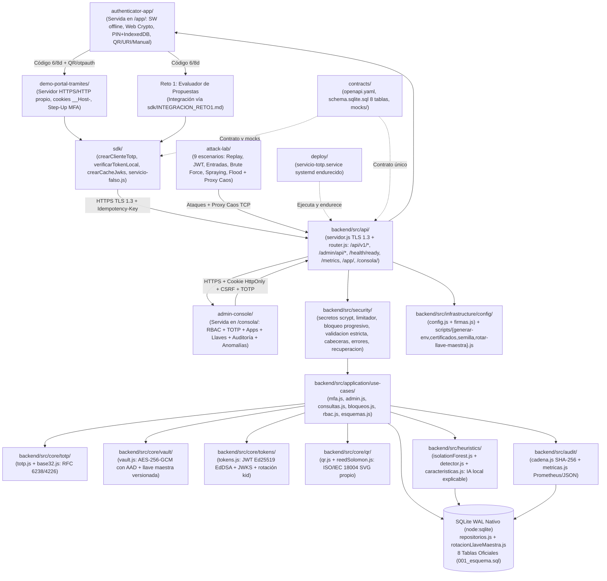

# Grafo de Arquitectura y Red del Sistema — Servicio Soberano TOTP

> **Protocolo Graphy:** Consultar antes de crear/modificar código; actualizar (alta/poda) en cada avance.
> **Estado actual:** Integración completa en rama `laya` (A1–A10 + B1–B6 verificados sobre el código real unificado; listo para PR `laya` → `staging` / Issue #16 C1).

## 1. Mapa de Conexiones (Red Viva)

## 2. Catálogo de Interfaces y Módulos Verificados

| Módulo | Archivos / Funciones Clave | Entradas / Salidas | Conexiones |
| :--- | :--- | :--- | :--- |
| `contracts/` | `openapi.yaml`, `schema.sqlite.sql` (8 tablas + índices completos), `mocks/*` (30 mocks) | Contrato API v1 + Admin + Resiliencia (`/health/ready`, `/metrics`, `Idempotency-Key`, `503`) | Todos los módulos |
| `backend/src/core/` | `totp/totp.js`, `vault/vault.js`, `tokens/tokens.js`, `qr/qr.js` | Criptografía pura RFC 6238, AES-256-GCM+AAD, JWT Ed25519/JWKS, QR SVG ISO 18004 | `application/use-cases`, `attack-lab` |
| `backend/src/infrastructure/` | `persistence/{db,repositorios,rotacionLlaveMaestra}.js`, `config/{config,firmas}.js` | SQLite WAL `node:sqlite`, anti-replay atómico, `consumed_jti`, gestión de llaves Ed25519 | `application/use-cases`, `api/servidor.js` |
| `backend/src/security/` | `secretos.js`, `limitador.js`, `bloqueo.js`, `validacion.js`, `cabeceras.js`, `errores.js`, `recuperacion.js` | Auth apps scrypt, rate limit, bloqueo progresivo, JSON estricto, errores genéricos | `api/servidor.js`, `use-cases/` |
| `backend/src/heuristics/` | `isolationForest.js`, `caracteristicas.js`, `detector.js` | Features conductuales locales -> score 0–100, nivel, acción adaptativa y razones explicables | `use-cases/mfa.js`, `/admin/api/anomalies` |
| `backend/src/audit/` | `cadena.js`, `metricas.js` | Bitácora encadenada `prev_hash -> hash` + métricas locales Prometheus (`/metrics`) y JSON (`/admin/api/metrics`) | `use-cases/`, `api/servidor.js` |
| `backend/src/api/` | `servidor.js`, `router.js`, `src/main.js` | Servidor HTTPS TLS 1.3 propio + rutas v1/admin + archivos estáticos `/app/` y `/consola/` | `sdk/`, `admin-console/`, `authenticator-app/`, `attack-lab/` |
| `authenticator-app/` | `index.html`, `sw.js`, `manifest.json`, `js/{app,totp,cripto,boveda,almacen,otpauth,escaner}.js` | PWA offline con PIN, IndexedDB cifrado, SHA-256/512 (6/8d) y alta por enlace/URI/Base32/cámara | Usuario final, `demo-portal-tramites/` |
| `admin-console/` | `index.html`, `js/{api,app,rbac,cadena,graficos,mock}.js`, `js/vistas/*.js` | Consola RBAC + TOTP contra `/admin/api/*` (con modo mock de respaldo) | `backend/src/api` |
| `sdk/` | `src/{index,cliente,http,jwks,jwt,local,errores}.js`, `testing/servicio-falso.js`, `INTEGRACION_RETO1.md` | `crearClienteTotp`, `verificarTokenLocal` offline, timeout 3 s + 1 reintento idempotente | `demo-portal-tramites/`, Reto 1 |
| `demo-portal-tramites/` | `server.js`, `src/{portal,sesiones,tramites,usuarios,vistas}.js`, `scripts/crear-usuarios.js` | Portal institucional demo con enrolamiento, verificación, step-up MFA y panel de traza | `sdk/`, `authenticator-app/` |
| `attack-lab/` | `ejecutar-todo.js`, `escenarios/*.js` (7 ataques), `caos/{proxy-caos,escenario-caos,reinicio}.js` | Ataques reales contra localhost + proxy TCP de caos + informe autocontenido JSON/HTML | `backend/src/api`, `backend/src/core/` |
| `deploy/` & `docs/sbom/` | `deploy/servicio-totp.service`, `docs/sbom/{generar-sbom.js,sbom.cdx.json}`, `docs/GUION_DEMO.md` | Unidad systemd endurecida, inventario CycloneDX 1.5 (0 deps npm) y guion de demo | Entrega / Producción |

## 3. Bitácora de Sincronización y Modelos

| Fecha | Acción (Alta / Poda / Refactor) | Módulos Afectados | Modelo Utilizado |
| :--- | :--- | :--- | :--- |
| 2026-11-26 | Alta inicial (Fase 1) | Estructura hexagonal base y contratos iniciales | Gemini Neon |
| 2026-11-26 | Refactor / Alineación con `origin/main` (`95c0fbd`) | Poda de `frontend/*` y `qa/`; alta de módulos oficiales y 8 tablas | Gemini Neon |
| 2026-11-26 | Integración unificada `origin/diego` + `laya` (A1–A10 + B1–B6) | Poda de archivos pre-integración duplicados; alta completa de backend real, clientes conectados, `deploy/servicio-totp.service`, `sdk/INTEGRACION_RETO1.md`, `docs/sbom/sbom.cdx.json` (8 módulos, 0 deps npm), `docs/GUION_DEMO.md` y `README.md` (6 apartados) | Gemini 4 Neon (High) |
