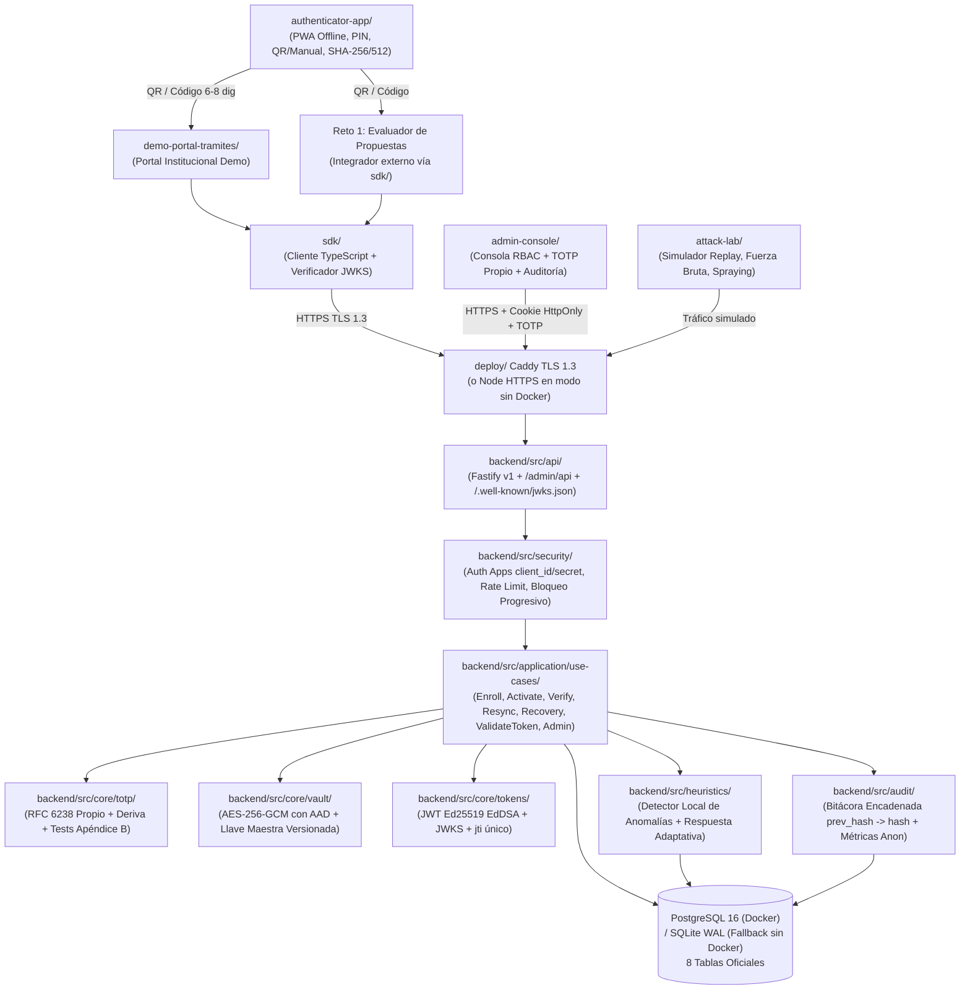

# Grafo de Arquitectura y Red del Sistema — Servicio Soberano TOTP

> **Protocolo Graphy:** Consultar antes de crear/modificar código; actualizar (alta/poda) en cada avance.
> **Estado actual:** Fase 1 — Alineado 100% con `docs/analisis/analisis-tecnico.html` (`origin/main`) + Puertos Hexagonales.

## 1. Mapa de Conexiones (Red Viva)

## 2. Catálogo de Interfaces y Contratos (`contracts/openapi.yaml` & `contracts/schema.sql`)

| Módulo / Interfaz | Funciones / Endpoints Clave | Entradas / Salidas | Conexiones / Consumidores |
| :--- | :--- | :--- | :--- |
| `backend/src/api/v1` | `POST /api/v1/enrollments`, `POST /api/v1/enrollments/{id}/activate`, `POST /api/v1/verify`, `POST /api/v1/tokens/validate`, `GET /.well-known/jwks.json`, `POST /api/v1/enrollments/{id}/resync`, `POST /api/v1/recovery`, `DELETE /api/v1/enrollments/{id}` | Credenciales App (`client_id`/`client_secret`) + JSON estricto -> QR SVG, códigos recuperación, JWT Ed25519, JWKS | `sdk/`, `demo-portal-tramites/`, `RETO1`, `attack-lab/`, `UC` |
| `backend/src/api/admin` | `POST /admin/api/login`, `GET/PUT /admin/api/apps`, `GET /admin/api/enrollments`, `POST /admin/api/keys/rotate`, `GET /admin/api/audit`, `GET /admin/api/audit/verify-chain`, `GET /admin/api/anomalies` | Cookie `HttpOnly; Secure; SameSite=Strict` + CSRF + RBAC -> Políticas, rotación `kid`, integridad de bitácora, alertas IA | `admin-console/`, `UC` |
| `backend/src/core/totp` | `generateHotp()`, `generateTotp()`, `verifyTotpWithDrift()`, `resyncTwoConsecutiveCodes()` | Seed Buffer + Epoch + Policy -> `{ valid, matchedStep, driftSteps }` | `UC` (Verify, Activate, Resync) |
| `backend/src/core/vault` | `generateSeed(alg)`, `encryptSeed(seed, enrollmentId, keyVer)`, `decryptSeed()`, `hashPepper(val, pepper)` | Buffer + AAD -> `{ ct, nonce, authTag, keyVersion }` | `UC`, `TOKENS` |
| `backend/src/core/tokens` | `signMfaJwt()`, `verifyMfaJwt()`, `getPublicJwks()`, `rotateEd25519Key()` | Claims + PrivateKey -> JWT `EdDSA` (`jti`, `kid`, `amr: ["otp"]`) / JWKS | `UC`, `API` |
| `backend/src/heuristics` | `evaluateRisk(signals)`, `recordAttempt()` | Features locales de `attempts` -> `{ riskScore, level, action, reasons, inferenceMs }` | `UC`, `admin-console/` |
| `backend/src/audit` | `appendChainedEvent()`, `verifyHashChain()` | Evento -> Fila encadenada (`prev_hash` -> `hash`) / `{ intact, brokenAtId }` | `UC`, `admin-console/` |
| `backend/src/infrastructure/persistence` | Repositorios para las 8 tablas: `apps`, `enrollments`, `recovery_codes`, `attempts`, `consumed_jti`, `signing_keys`, `admins`, `audit_log` | Puertos Hexagonales <-> PostgreSQL 16 / SQLite WAL | Todos los casos de uso |

## 3. Bitácora de Sincronización y Modelos

| Fecha | Acción (Alta / Poda / Refactor) | Módulos Afectados | Modelo Utilizado |
| :--- | :--- | :--- | :--- |
| 2026-11-26 | Alta inicial (Fase 1) | Estructura hexagonal base y contratos iniciales | Gemini Neon |
| 2026-11-26 | Refactor / Alineación 100% con `origin/main` (`95c0fbd`) | Poda de `frontend/*` y `qa/`; alta de `backend/src/core/{totp,vault,tokens}`, `security/`, `heuristics/`, `audit/`, `api/`, `authenticator-app/`, `admin-console/`, `demo-portal-tramites/`, `attack-lab/`, `deploy/`, 9 endpoints v1 y 8 tablas oficiales (con `audit_log` encadenado y `recovery_codes`) | Gemini Neon |
