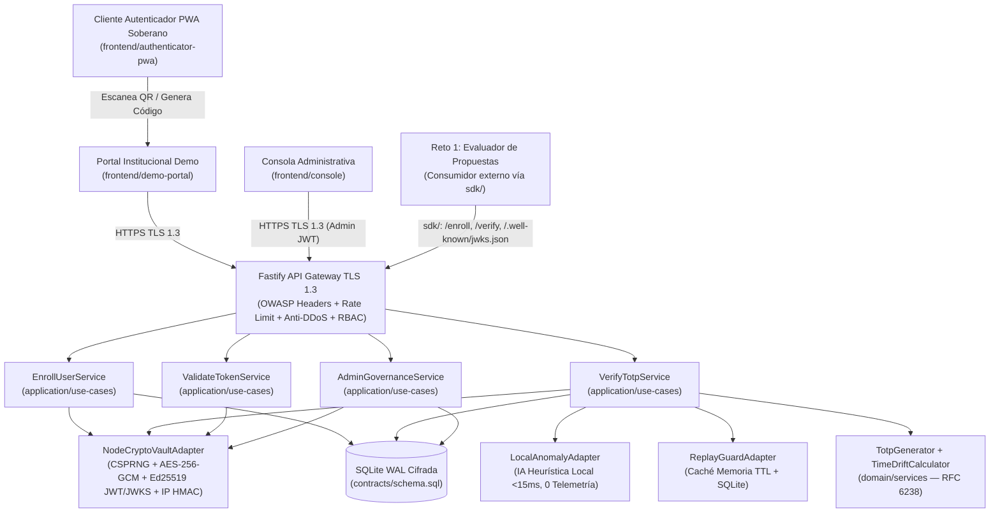

# Grafo de Arquitectura y Red del Sistema — Servicio Soberano MFA / TOTP

> **Protocolo Graphy:** Todo agente y desarrollador debe consultar este grafo antes de crear o modificar módulos, y actualizarlo (alta/poda) en cada avance arquitectónico.
> **Estado actual:** Fase 1 (Estructura Hexagonal y Contratos Congelados en `contracts/`).

## 1. Mapa de Conexiones (Red Viva — Arquitectura Hexagonal)

## 2. Catálogo de Interfaces y Contratos Congelados (`contracts/openapi.yaml`)

| Módulo / Interfaz | Funciones / Endpoints Clave | Entradas / Salidas | Conexiones / Consumidores |
| :--- | :--- | :--- | :--- |
| `HttpAuthController` (`backend/src/infrastructure/adapters/in/http`) | `POST /api/v1/enroll`, `POST /api/v1/verify`, `POST /api/v1/token/validate`, `GET /.well-known/jwks.json`, `GET /health` | DTOs JSON -> QR/URI `otpauth://`, JWT `EdDSA`, JWKS público | `PWA`, `DEMO`, `RETO1`, `EnrollUserService`, `VerifyTotpService`, `ValidateTokenService` |
| `HttpAdminController` (`backend/src/infrastructure/adapters/in/http`) | `POST /api/v1/admin/login`, `GET/PUT /api/v1/admin/policies`, `POST /api/v1/admin/keys/rotate`, `POST /api/v1/admin/users/:id/revoke`, `GET /api/v1/admin/audit`, `GET /api/v1/admin/anomalies` | Admin JWT -> Políticas, Rotación `kid`, Auditoría anonimizada, Alertas IA | `ADMIN`, `AdminGovernanceService` |
| `TotpGenerator` (`backend/src/domain/services`) | `generateCode(secret, step, alg, digits)`, `verifyWithDrift(secret, code, now, policy)` | Buffer + Timestamp -> `{ valid, matchedStep, driftSteps }` | `VerifyTotpService` |
| `CryptoVaultPort` (`backend/src/application/ports/out`) | `generateSeed()`, `encryptAes256Gcm()`, `decryptAes256Gcm()`, `signMfaJwt()`, `verifyMfaJwt()`, `getPublicJwks()`, `rotateSigningKey()`, `anonymizeIp()` | Plaintext/Claims -> Ciphertext/JWT/JWKS/HMAC | `EnrollUserService`, `VerifyTotpService`, `ValidateTokenService`, `AdminGovernanceService` |
| `ReplayGuardPort` (`backend/src/application/ports/out`) | `isCodeUsed(enrollmentId, step)`, `markCodeUsed(enrollmentId, step, expiresAt)` | `(enrollmentId, step)` -> `boolean` | `VerifyTotpService` |
| `AnomalyDetectorPort` (`backend/src/application/ports/out`) | `evaluateAttempt(signals)`, `recordAttempt(signals, outcome)` | Señales locales anonimizadas -> `{ riskScore, level, action, reasons }` | `VerifyTotpService`, `HttpAdminController` |
| `SqliteRepositoryAdapter` (`backend/src/infrastructure/adapters/out/persistence`) | CRUD de `user_enrollments`, `totp_policies`, `signing_keys`, `replay_guard`, `auth_audit_events`, `anomaly_alerts` | Entidades <-> SQLite WAL | Todos los casos de uso |
| `MfaClientSdk` (`sdk/`) | `enroll()`, `verify()`, `validateTokenOnline()`, `verifyJwtOffline(token, jwksUrl)` | API REST / JWKS -> Sesión verificada | `RETO1`, `DEMO` |

## 3. Bitácora de Sincronización y Modelos

| Fecha | Acción (Alta / Poda / Refactor) | Módulos Afectados | Modelo Utilizado |
| :--- | :--- | :--- | :--- |
| 2026-11-26 | Alta inicial (Fase 1 — Esqueleto Hexagonal y Contratos Congelados) | `AGENTS.md`, `ARCHITECTURE.md`, `contracts/openapi.yaml`, `contracts/schema.sql`, `contracts/mocks/`, estructura `backend/src/` y `frontend/` | Gemini Neon |
