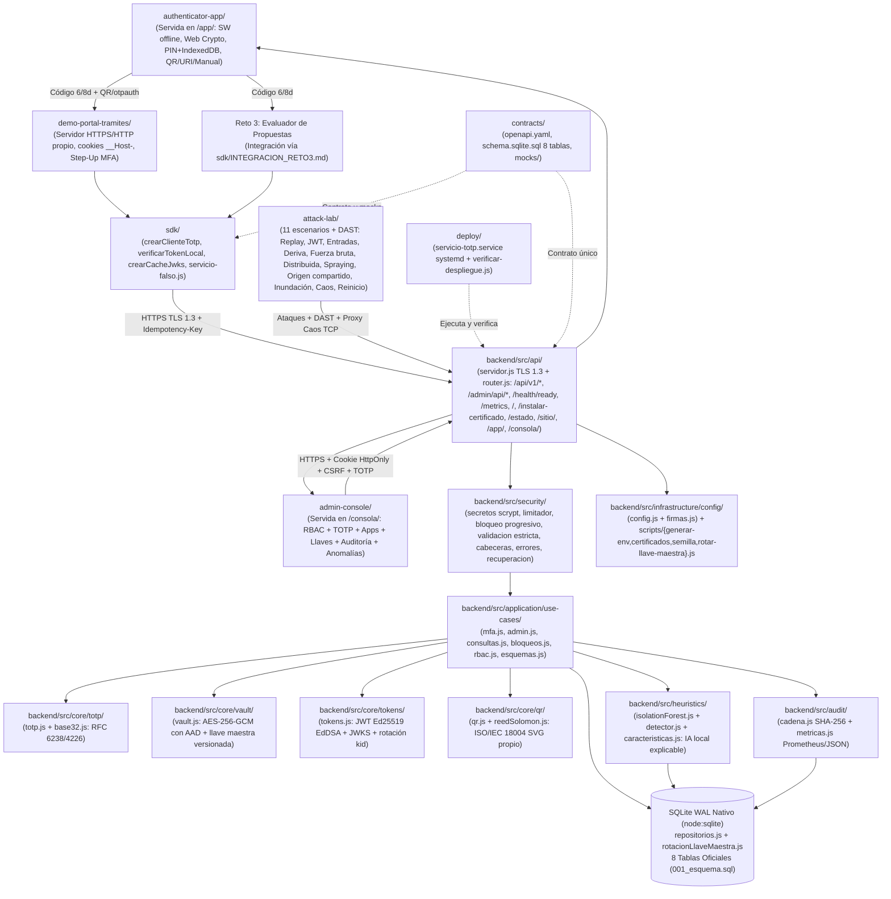

# Grafo de Arquitectura y Red del Sistema — Servicio Soberano TOTP

> Mapa vivo de módulos, interfaces, flujos y dependencias del proyecto.
> **Estado actual:** Integración completa ADR-002 (Node.js 22.5+ nativo, 0 dependencias npm, SQLite WAL, TLS 1.3, DAST propio y verificación institucional `systemd`).

## 1. Mapa de Conexiones (Red del Sistema)

## 2. Catálogo de Interfaces y Módulos

| Módulo | Archivos / Funciones Clave | Entradas / Salidas | Conexiones |
| :--- | :--- | :--- | :--- |
| `contracts/` | `openapi.yaml`, `schema.sqlite.sql` (8 tablas + índices), `mocks/*` | Contrato API v1 + Admin + Resiliencia (`/health/ready`, `/metrics`, `Idempotency-Key`, `503`) | Todos los módulos |
| `backend/src/core/` | `totp/totp.js`, `vault/vault.js`, `tokens/tokens.js`, `qr/qr.js` | Criptografía pura RFC 6238, AES-256-GCM+AAD, JWT Ed25519/JWKS, QR SVG ISO 18004 | `application/use-cases`, `attack-lab` |
| `backend/src/infrastructure/` | `persistence/{db,repositorios,rotacionLlaveMaestra}.js`, `config/{config,firmas}.js` | SQLite WAL `node:sqlite`, anti-replay atómico, `consumed_jti`, gestión de llaves Ed25519 | `application/use-cases`, `api/servidor.js` |
| `backend/src/security/` | `secretos.js`, `limitador.js`, `bloqueo.js`, `validacion.js`, `cabeceras.js`, `errores.js`, `recuperacion.js` | Auth apps scrypt, rate limit, bloqueo progresivo, JSON estricto, errores genéricos | `api/servidor.js`, `use-cases/` |
| `backend/src/heuristics/` | `isolationForest.js`, `caracteristicas.js`, `detector.js` | Features conductuales locales -> score 0–100, nivel, acción adaptativa y razones explicables | `use-cases/mfa.js`, `/admin/api/anomalies` |
| `backend/src/audit/` | `cadena.js`, `metricas.js` | Bitácora encadenada `prev_hash -> hash` + métricas locales Prometheus (`/metrics`) y JSON (`/admin/api/metrics`) | `use-cases/`, `api/servidor.js` |
| `backend/src/api/` | `servidor.js`, `router.js`, `src/main.js` | Servidor HTTPS TLS 1.3 propio + rutas v1/admin + páginas públicas `/`, `/instalar-certificado`, `/estado` y estáticos `/sitio/`, `/app/`, `/consola/` | `sdk/`, `admin-console/`, `authenticator-app/`, `sitio-publico/`, `attack-lab/` |
| `authenticator-app/` | `index.html`, `sw.js`, `manifest.json`, `js/{app,totp,cripto,boveda,almacen,otpauth,escaner}.js` | PWA offline con PIN, IndexedDB cifrado, SHA-256/512 (6/8d) y alta por enlace/URI/Base32/cámara | Usuario final, `demo-portal-tramites/` |
| `admin-console/` | `index.html`, `js/{api,app,rbac,cadena,graficos,mock}.js`, `js/vistas/*.js` | Consola RBAC + TOTP contra `/admin/api/*` (con modo mock de respaldo) | `backend/src/api` |
| `sdk/` | `src/{index,cliente,http,jwks,jwt,local,errores}.js`, `testing/servicio-falso.js`, `INTEGRACION_RETO3.md` | `crearClienteTotp`, `verificarTokenLocal` offline, timeout 3 s + 1 reintento idempotente | `demo-portal-tramites/`, Reto 3 |
| `demo-portal-tramites/` | `server.js`, `src/{cedula,portal,sesiones,tramites,usuarios,vistas}.js`, `scripts/crear-usuarios.js` | Portal institucional demo con cédula (V/E), enrolamiento, verificación, step-up MFA, centro de ayuda `/ayuda` y panel de traza | `sdk/`, `authenticator-app/` |
| `attack-lab/` | `ejecutar-todo.js`, `escenarios/*.js` (incl. `dast.js`), `caos/{proxy-caos,escenario-caos,reinicio}.js` | Ataques reales, escáner DAST propio y proxy TCP de caos -> informes JSON/HTML autocontenidos | `backend/src/api`, `backend/src/core/` |
| `deploy/` & `docs/` | `deploy/servicio-totp.service`, `deploy/verificar-despliegue.js`, `docs/sbom/`, `docs/cumplimiento/`, `docs/evidencias/` | Unidad `systemd` verificada, inventario CycloneDX 1.5 (0 deps npm), matriz de cumplimiento y evidencias | Entrega / Producción |
| `sitio-publico/` | `index.html`, `instalar-certificado.html`, `estado.html`, `css/sitio.css`, `js/{sitio,certificado,estado}.js`, `img/*.svg` | Inicio ciudadano (`/`), guía de certificado (`/instalar-certificado`, `/ca.crt` con huella SHA-256) y página `/estado` (cada 30 s) montados en `backend/src/main.js` con CSP estricta | `backend/src/api` (`/health/ready`, `/ca.crt`, `/sitio/`, `/app/`, `/consola/`) |
| `mobile-android/` | `README.md`, `AndroidManifest.xml`, `core/{TotpEngine,CedulaValidator,OtpAuthParser}.kt`, `security/{KeystoreVault,PinManager}.kt`, `TotpEngineTest.kt` | ADR-004 Android nativo Kotlin sin librerías de terceros (RFC 6238/4226, cédula V/E, parser `otpauth://`, Keystore AES-256-GCM StrongBox/TEE, PIN PBKDF2 + bloqueo progresivo, `allowBackup="false"`) | Portal institucional y `backend/src/api` |
| `scripts/` & CI | `scripts/verificar-todo.js`, `scripts/capturas.js`, `.gitlab-ci.yml`, `.github/workflows/pruebas.yml` | CI sin dependencias (OpenAPI estricto, 5 suites con cobertura, SBOM, higiene) y capturas headless Chromium | Todo el repositorio |

## 3. Bitácora de Evolución Arquitectónica

| Fecha | Acción (Alta / Poda / Refactor) | Módulos Afectados |
| :--- | :--- | :--- |
| 2026-11-26 | Alta inicial de estructura modular y contratos | `contracts/`, estructura base y documentos raíz |
| 2026-11-26 | Adopción de ADR-002 (Node.js 22 nativo, 0 dependencias npm, SQLite WAL) | Poda de PostgreSQL/Docker/Fastify/React; alta completa de `backend/`, `authenticator-app/`, `admin-console/`, `sdk/`, `demo-portal-tramites/`, `attack-lab/`, `deploy/` |
| 2026-11-26 | Alta de DAST propio (`#24`), verificación `systemd` (`#25`) y limpieza final (`#26`) | `attack-lab/escenarios/dast.js`, `attack-lab/tests/dast.test.js`, `deploy/verificar-despliegue.js`, `docs/evidencias/`, `docs/sbom/` |
| 2026-11-26 | Alta de CI sin dependencias (`#31`), compatibilidad Key URI (`#29`), limpieza README (`#30`), ADR-004 + `mobile-android/` (`#39`–`#41`), `sitio-publico/` (`#48`, `#49`, `#52`), capturas (`#51`) y accesibilidad (`#33`, `#50`) | `scripts/verificar-todo.js`, `.gitlab-ci.yml`, `.github/workflows/pruebas.yml`, `mobile-android/`, `sitio-publico/`, `scripts/capturas.js`, `docs/evidencias/` |
| 2026-11-26 | Montaje de `sitio-publico/` en backend (`#48`, `#49`, `#52`), centro de ayuda `/ayuda` en portal demo (`#53`) y expansión de `mobile-android/` con cédula V/E, KeystoreVault, PinManager y OtpAuthParser (`#40`–`#43`) | `backend/src/api/servidor.js`, `backend/src/main.js`, `sitio-publico/`, `demo-portal-tramites/`, `mobile-android/` |
