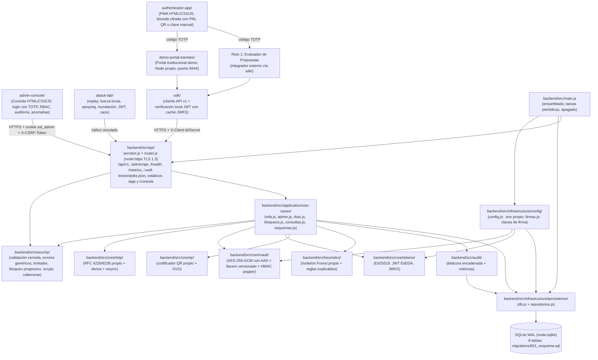

# Grafo de Arquitectura y Red del Sistema — Servicio Soberano TOTP

> **Protocolo Graphy:** consultar antes de crear o modificar código; actualizar (alta/poda) en cada avance.
> **Estado actual:** backend implementado y probado (156 pruebas). Grafo alineado con el código el 26-11-2026.

## 1. Mapa de Conexiones (Red Viva)

## 2. Catálogo de Interfaces y Contratos (`contracts/openapi.yaml` y `contracts/schema.sqlite.sql`)

| Módulo / Interfaz | Funciones / Endpoints clave (exportados) | Entradas / Salidas | Conexiones / Consumidores |
| :--- | :--- | :--- | :--- |
| API v1 (`api/servidor.js`) | `POST /api/v1/enrollments`, `POST /api/v1/enrollments/{id}/activate`, `POST /api/v1/enrollments/{id}/resync`, `DELETE /api/v1/enrollments/{id}`, `POST /api/v1/verify`, `POST /api/v1/tokens/validate`, `POST /api/v1/recovery` | `X-Client-Id`/`X-Client-Secret` + JSON cerrado (16 KiB) → QR SVG, códigos de recuperación, JWT Ed25519; errores `GenericError` | `sdk/`, `demo-portal-tramites/`, Reto 1, `attack-lab/` |
| Sistema (`api/servidor.js`) | `GET /health`, `GET /health/ready`, `GET /metrics` (texto, solo local o sesión con `metricas.leer`), `GET /.well-known/jwks.json` | — → estado, preparación de la base, métricas, JWKS | Operación, `sdk/` |
| Consola (`api/servidor.js`) | `POST /admin/api/login`, `GET /admin/api/session`, `POST /admin/api/logout`, `GET/POST /admin/api/apps`, `GET /admin/api/enrollments`, `POST /admin/api/keys/rotate`, `GET /admin/api/audit`, `GET /admin/api/audit/verify-chain`, `GET /admin/api/anomalies`, `GET /admin/api/metrics` | Cookie `sst_admin` (`HttpOnly; Secure; SameSite=Strict; Path=/admin`) + `X-CSRF-Token` + RBAC | `admin-console/` |
| `api/` | `crearServidor({ casos, metricas, limitadores, cors, salud, info, puede, tls, registro, estaticos, ... })`, `crearRouter()`, `LIMITE_CUERPO_BYTES`, `NOMBRE_COOKIE_SESION`, `DURACION_SESION_MS` | Casos de uso → servidor `node:https` sin `listen()` | `main.js` |
| `application/use-cases/` | `crearCasosDeUso(deps)` → `enrolar`, `activar`, `verificar`, `validarToken`, `resincronizar`, `recuperar`, `revocar`, `jwks`, `autenticarApp`, `adminLogin`, `adminListarApps`, `adminActualizarApp`, `adminListarEnrolamientos`, `adminRotarLlaves`, `adminAuditoria`, `adminVerificarCadena`, `adminAnomalias`, `adminMetricas`; `puede(rol, accion)`, `MATRIZ_RBAC`, `ACCIONES` | `(entrada, ctx)` → `{ status, cuerpo, cabeceras }` | `api/`, `scripts/semilla.js` |
| `core/totp` | `generateHotp()`, `generateTotp()`, `verifyTotpWithDrift()`, `resyncTwoConsecutiveCodes()`, `buildOtpauthUri()`, `pasoDeTiempo()`, `LONGITUD_SEMILLA`; `base32Encode()`, `base32Decode()` | Semilla Buffer + epoch + política → `{ valid, matchedStep, driftSteps, reason }` | Casos de uso, `scripts/semilla.js` |
| `core/vault` | `generateSeed(alg)`, `crearVault({ llaves, versionActiva })` → `encryptSeed`, `decryptSeed`, `encryptBlob`, `decryptBlob`, `reencrypt`; `llavesDesdeEntorno(env)`, `hashPepper()`, `pepperDiario()` | Buffer + contexto AAD → `{ ct, nonce, authTag, keyVersion }` | Casos de uso, `infrastructure/config` |
| `core/tokens` | `generarParFirma()`, `calcularKid()`, `signMfaJwt()`, `verifyMfaJwt()`, `getPublicJwks()`, `base64urlEncode()`, `base64urlDecode()` | Claims + clave privada → JWT `EdDSA` (`jti`, `kid`, `amr: ["otp"]`) / JWKS | `infrastructure/config/firmas.js`, casos de uso |
| `core/qr` | `encodeQr(texto, { nivel, mascara })`, `qrToSvg(qr, opciones)` (+ utilidades de versión/capacidad y Reed-Solomon) | URI `otpauth://` → matriz → SVG | Casos de uso (`enrolar`) |
| `security/` | `validarCuerpo()`, `errorGenerico()`, `crearLimitador()`, `calcularBloqueo()`, `bloqueadoHasta()`, `estaBloqueado()`, `ESCALONES_BLOQUEO`, `hashSecreto(Async)()`, `verificarSecreto(Async)()`, `generarSecretoCliente()`, `generarClientId()`, `generarCodigosRecuperacion()`, `normalizarCodigoRecuperacion()`, `cabecerasSeguridad()` | Entradas no confiables → valores saneados, respuestas genéricas, hashes scrypt | `api/`, casos de uso |
| `heuristics/` | `entrenarDetectorPorDefecto()`, `crearDetector()` → `evaluar(intento, historial, ahora)`, `aRiesgoContrato()`, `extraerCaracteristicas()`, `entrenar()`/`puntuar()` (Isolation Forest), generador de tráfico sintético | Historial de `attempts` (solo hashes) → `{ riskScore, level, action, reasons, inferenceMs }` | Casos de uso (`verificar`), `main.js` |
| `audit/` | `crearBitacora({ ultimo, insertar })` → `registrar()`, `verificarCadena()`, `respuestaVerificacion()`, `calcularHash()`, `serializarCanonico()`, `filtrarSensibles()`; `crearMetricas()` → `registrarPeticion()`, `registrarResultadoVerificacion()`, `registrarInferencia()`, `instantanea()`, `formatoTexto()` | Evento → fila encadenada (`prev_hash` → `hash`) / `{ intact, checked_records, broken_at_id, last_hash }` | Casos de uso, `api/`, `main.js` |
| `infrastructure/persistence` | `abrirBaseDatos(ruta)`, `aplicarMigraciones()`, `crearRepositorios(db)` → `apps`, `enrollments`, `recoveryCodes`, `attempts`, `consumedJti`, `signingKeys`, `admins`, `auditLog`, `transaccion()` | SQL parametrizado ↔ SQLite WAL (8 tablas) | Casos de uso, `main.js`, scripts |
| `infrastructure/config` | `cargarConfig()`, `validarConfig()`, `parsearEnv()`, `leerVariables()`, `configCasosDeUso()`, `ErrorConfiguracion`; `crearFirmas({ repos, vault })` → `recargar()`, `activa()`, `jwks()`, `buscarClave()`, `rotar()` | `backend/.env` o `ENV_FILE` + entorno → configuración congelada; claves Ed25519 cifradas | `main.js`, scripts |
| `sdk/` | `crearClienteTotp()`, `claveDeOtpauth()`, `verificarTokenLocal()`, `crearCacheJwks()`, `decodificarSinVerificar()`, `ErrorTotp` | API v1 → objetos JS; JWT + JWKS → claims verificados | `demo-portal-tramites/`, Reto 1 |

## 3. Bitácora de Sincronización

| Fecha | Acción (Alta / Poda / Refactor) | Módulos Afectados |
| :--- | :--- | :--- |
| 2026-11-26 | Alta inicial (Fase 1) | Estructura base y contratos iniciales |
| 2026-11-26 | Refactor / Alineación con `origin/main` (`95c0fbd`) | Poda de `frontend/*` y `qa/`; alta de `backend/src/core/{totp,vault,tokens}`, `security/`, `heuristics/`, `audit/`, `api/`, `authenticator-app/`, `admin-console/`, `demo-portal-tramites/`, `attack-lab/`, `deploy/`, 9 endpoints v1 y 8 tablas oficiales (con `audit_log` encadenado y `recovery_codes`) |
| 2026-11-26 | Alineación con el código implementado | Alta de `core/qr`, `infrastructure/config/firmas.js`, `main.js`, rutas `/health/ready`, `/metrics`, `/admin/api/{session,logout,enrollments,metrics}`; poda de Fastify, TypeScript, React/Vite, Caddy, Docker Compose, PostgreSQL como base principal y puertos hexagonales `ports/in|out`; catálogo con las funciones exportadas reales |
