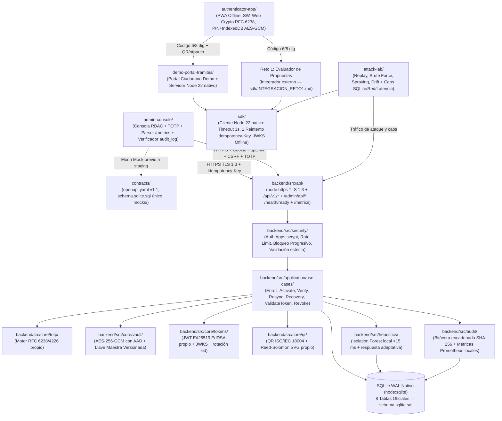

# Grafo de Arquitectura y Red del Sistema — Servicio Soberano TOTP

> **Protocolo Graphy:** Consultar antes de crear/modificar código; actualizar (alta/poda) en cada avance.
> **Estado actual:** Fase 2 (Área B completa en rama `laya`: B1–B6 terminados y verificados; alineado 100 % a ADR-002 cero dependencias npm + SQLite WAL nativa).

## 1. Mapa de Conexiones (Red Viva)

## 2. Catálogo de Interfaces y Contratos (`contracts/openapi.yaml` v1.1 & `contracts/schema.sqlite.sql`)

| Módulo / Interfaz | Archivos y Funciones Clave | Entradas / Salidas | Consumidores / Conexiones |
| :--- | :--- | :--- | :--- |
| `contracts/` | `openapi.yaml` v1.1, `schema.sqlite.sql`, `mocks/*.json`, `mocks/metrics.txt` | Contrato único (`/health/ready`, `/metrics`, `Idempotency-Key`, `503`) + 8 tablas SQLite | Área A (`backend/`) y Área B (`sdk/`, `admin-console/`, `demo-portal-tramites/`, `attack-lab/`) |
| `authenticator-app/` | `totp-core.js` (`generateHotp`, `generateTotp`, `decodeBase32`, `parseOtpAuthUri`, `encryptVaultData`, `decryptVaultData`), `vault-idb.js`, `sw.js`, `manifest.json`, `app.js` | Semillas Base32 / `otpauth://` + PIN -> Bóveda IndexedDB cifrada + códigos TOTP 6/8d con anillo 30s offline | Usuario ciudadano / Evaluador Reto 1 / Administrador |
| `admin-console/` | `admin-api.js` (`createAdminClient`, `getPermissions`, `parsePrometheusMetrics`, `verifyLocalAuditLinks`), `app.js`, `index.html` | RBAC (`Administrador`/`Operador`/`Auditor`) + TOTP -> Apps/políticas, revocación, rotación `kid`, verificador `audit_log`, alertas IA y `/metrics` | `contracts/mocks/` (modo mock) o `backend/src/api` (modo live) |
| `sdk/` | `index.js` (`createTotpClient`, `TotpServiceError`), `jwks-verifier.js` (`verifyJwtWithJwks`), `INTEGRACION_RETO1.md` | `enroll`, `activate`, `verify` (timeout 3s + 1 reintento `Idempotency-Key`), `validateToken`, `verifyJwtOffline` (caché JWKS Ed25519), `resync`, `recover`, `revoke` | `demo-portal-tramites/`, `attack-lab/`, sub-equipo Reto 1 |
| `demo-portal-tramites/` | `server.js` (`createPortalServer`), `app.js`, `index.html` | Flujo ciudadano 3 pasos (usuario+clave → TOTP → expediente protegido con JWT Ed25519) + sirve `/authenticator/` y `/admin/` | `sdk/`, `authenticator-app/`, `admin-console/` |
| `attack-lab/` | `run-all.js` (`runAttackAndChaosSuite`), `harness-server.js`, `REPORTE_DEMO.md`, `reporte-demo.json` | 4 escenarios de ataque + 3 pruebas de caos -> reporte de mitigación, latencia p95 y 0 accesos indebidos | `sdk/`, API real o harness local |
| `docs/sbom/` | `generar-sbom.js`, `sbom.cdx.json` | Inventario CycloneDX 1.5 de módulos propios con hashes SHA-256 y 0 dependencias npm externas | Entrega / Auditoría / Jurado |
| `backend/` (Área A) | `core/{totp,vault,tokens,qr}`, `infrastructure/persistence`, `security`, `audit`, `heuristics`, `application`, `api` | API HTTPS Node 22 + SQLite WAL (implementación en rama `diego`) | Integración en `staging` (Issue #16 C1) |

## 3. Bitácora de Sincronización y Modelos

| Fecha | Acción (Alta / Poda / Refactor) | Módulos Afectados | Modelo Utilizado |
| :--- | :--- | :--- | :--- |
| 2026-11-26 | Alta inicial (Fase 1) | Estructura hexagonal base y contratos iniciales | Gemini Neon |
| 2026-11-26 | Refactor / Alineación con `origin/main` (`95c0fbd`) | Poda de `frontend/*` y `qa/`; alta de módulos oficiales y 8 tablas | Gemini Neon |
| 2026-11-26 | Alta completa Área B (Issues #10–#15: B1–B6) + Poda de PostgreSQL/Docker/React/Fastify según ADR-002 | `contracts/` (v1.1 resiliencia + SQLite única), `authenticator-app/`, `admin-console/`, `sdk/`, `demo-portal-tramites/`, `attack-lab/`, `docs/sbom/`, `docs/GUION_DEMO.md`, `README.md`, `AGENTS.md`, `ARCHITECTURE.md` | Gemini 4 Neon (High) |
