# Informe de Pruebas QA en Navegador Real (E2E) — Servicio Soberano TOTP

> **Fecha:** 2026-11-26  
> **Rama evaluada:** `laya` (`b738709`)  
> **Entorno:** Backend HTTPS TLS 1.3 (`https://localhost:8443`) + Portal de Trámites Demo HTTPS (`https://localhost:8444`) enlazados en vivo sobre **Node.js `v26.13.1`** (0 dependencias npm) y Chromium real.

---

## Veredicto

**`PASS CON OBSERVACIONES`**

- **Pruebas automatizadas (`node scripts/verificar-todo.js`):** **`311 / 311` en verde (0 fallos)** — Backend (212), App Autenticadora PWA (26), SDK (28), Portal de Trámites Demo (17), Attack Lab y DAST (28), OpenAPI estricto (234 `$ref` resueltas), SBOM CycloneDX 1.5 (0 dependencias npm externas, 0 recursos externos) e higiene del repositorio OK.
- **Flujos críticos E2E en navegador real: 100 % operativos.** Se verificó de punta a punta: ingreso ciudadano por cédula (`V-10.000.001`), enrolamiento con QR y enlace directo `#add=otpauth://` hacia la PWA `/app/`, creación de bóveda cifrada AES-256-GCM en IndexedDB con PIN (rechazo de PIN débil `123456`, validación de coincidencia y persistencia tras recarga `F5`), generación de código TOTP `SHA-256` real en Web Crypto, activación en el Portal, entrega de 10 códigos de recuperación, inicio de sesión 2FA con verificación de firma Ed25519/JWKS + consumo de `jti`, Step-Up MFA con **Anti-Replay** efectivo, comportamiento **Fail-Closed** ante indisponibilidad del servicio, centro de ayuda `/ayuda` (5 preguntas frecuentes), Consola Administrativa RBAC 2FA (7/7 secciones) y **verificación dual de cadena SHA-256** (servidor + navegador: 17/17 registros íntegros).
- **Hallazgos:** `0` bloqueantes, **`1` hallazgo de severidad media (`H1`)** y **`4` observaciones de severidad baja (`H2`–`H5`)**.

---

## 1. Matriz de Pruebas Ejecutada

| Flujo / Módulo | Escritorio (`1280×960`) | Móvil (`390×844` y `320×568`) | Consola / Red | Estado |
| :--- | :---: | :---: | :---: | :---: |
| **Sitio público — Inicio (`/`)** y modo oscuro | `0` overflow, `0` imágenes rotas, tema oscuro OK | `0` overflow, `0` controles `< 44px` | `0` errores JS · `0` HTTP `>= 400` | **PASS** |
| **Sitio público — Estado (`/estado`)** | Estado operativo, hora UTC y desfase en vivo | `0` overflow, `0` controles `< 44px` | `0` errores JS · `0` HTTP `>= 400` | **PASS** |
| **Sitio público — Certificado (`/instalar-certificado`)** | Render limpio y aviso degradado | `0` overflow, `0` controles `< 44px` | **`404` en `GET /ca.crt`** (`TLS_CA_PUBLIC_PATH` vacío tras `npm run env`) | **OBS (Media)** |
| **Portal Demo — Acceso y Enrolamiento (`/ingresar`, `/enrolar`)** | Rechaza clave errónea (`401`); genera QR `data:` válido y enlace `#add=` | `0` overflow · `0` inputs `< 16px` · botón `Menú` de `41px` | `0` errores JS · solo `401` esperados en pruebas hostiles | **PASS** |
| **PWA Autenticadora (`/app/`) — PIN, Bóveda y TOTP en vivo** | Rechaza PIN débil/distinto; persiste tras `F5`; calcula `SHA-256` real | `0` overflow, `0` controles `< 44px` · `#uri`/`#i-archivo` en `15px` | `0` errores JS (aviso SW esperable con CA autofirmada sin instalar) | **PASS** |
| **Portal Demo — Activación, Panel, Step-Up MFA y `/ayuda`** | Activa con código PWA → 10 códigos recuperación → Panel EdDSA/JWKS → **Anti-Replay bloqueado** en Step-Up → `/ayuda` (5 FAQs) | `0` overflow, `0` `[hidden]` rotos · botones `Menú`/`Salir` `< 44px` | `0` errores JS · `0` respuestas inesperadas | **PASS** |
| **Portal Demo — Resiliencia *Fail-Closed*** | Verificado en vivo: el SDK reintenta 1 vez con la misma `Idempotency-Key` y deniega el acceso | N/A | Sin filtración de errores internos | **PASS** |
| **Consola RBAC (`/consola/`) — Login 2FA, 7 vistas, Auditoría SHA-256 y Logout** | Auto-envío OTP, 7/7 secciones operativas, cadena SHA-256 íntegra (servidor + navegador), diálogo de cierre de sesión OK, transiciones sin glitches | `0` overflow, menú lateral `#boton-menu` fluido y cierra con `#velo` · enlaces nav `38px`, login inputs `14px` | `0` errores JS · `0` HTTP inesperados (salvo `401` inicial de `/admin/api/me` sin sesión) | **PASS** |

---

## 2. Hallazgos y Observaciones

### [MEDIA] H1 — `GET /ca.crt` devuelve `404` tras el arranque por defecto (`npm run env && npm run certs`)
- **Ubicación:** `backend/scripts/generar-env.js`, `.env.example` y `/instalar-certificado`.
- **Cómo reproducir:**
  1. Ejecutar `cd backend && npm run env && npm run certs && npm run seed && npm start`.
  2. Abrir `https://localhost:8443/instalar-certificado`.
- **Esperado:** `/ca.crt` entrega el certificado público de la CA (`application/x-x509-ca-cert`) y la página calcula y muestra automáticamente su huella SHA-256.
- **Actual:** `GET /ca.crt` responde `404 Not Found` porque `TLS_CA_PUBLIC_PATH` queda sin definir en el `.env` generado por `npm run env`. La interfaz degrada mostrando el aviso amarillo *"No se pudo obtener /ca.crt automáticamente en este entorno"*.
- **Acción recomendada:** Definir `TLS_CA_PUBLIC_PATH=./certs/ca.crt` en `.env.example` (o documentarlo como paso explícito antes de las pruebas en teléfono físico).

### [BAJA] H2 — Recorte lateral y corte de palabras en tablas de la Consola (`1280px`)
- **Ubicación:** `/consola/` — vistas *Panel*, *Enrolamientos* y *Auditoría*.
- **Detalle:**
  - En *Panel* («Latencia por ruta»), las rutas se parten a mitad de palabra (`/health/read` + `y`, `/api/v1/veri` + `fy`).
  - En *Enrolamientos* y *Auditoría* a `1280px`, las columnas del extremo derecho (`Último uso`/acciones y `Detalle`) requieren scroll horizontal interno dentro de la tabla y se ven parcialmente recortadas en el borde derecho.

### [BAJA] H3 — Toast inferior se superpone al pie en la PWA de escritorio
- **Ubicación:** `/app/` en escritorio (`1280×960`).
- **Detalle:** Al guardar una cuenta nueva, el aviso emergente *"Cuenta de ServicioSoberanoTOTP guardada"* se ubica encima del texto *"Servicio Soberano de Autenticación"* del pie de página. Elevar su posición inferior (`bottom: 4rem`) evita el solapamiento.

### [BAJA] H4 — Tamaños táctiles `< 44px` e inputs `< 16px` en móvil (`390×844` / `320×568`)
- **Consola (`/consola/`):** `#login-usuario` y `#login-password` tienen `font-size: 14px` (en iOS Safari conviene `>= 16px` para evitar zoom automático al enfocar); los enlaces del menú lateral miden `38px` de altura.
- **PWA (`/app/`):** `#uri` (área de texto en pestaña *Pegar*) y `#i-archivo` tienen `font-size: 15px`.
- **Portal (`/panel`):** El botón `Menú` mide `41px` de alto y el control de barra superior `36px`.

### [BAJA] H5 — Enlaces demostrativos con destino `#` en el pie del Portal
- **Ubicación:** `demo-portal-tramites/src/vistas.js` (`Términos de uso`, `Política de privacidad`, `Accesibilidad`, `Código fuente (AGPL-3.0)`).
- **Detalle:** Apuntan a `#` como marcadores de demostración; conviene aclararlo si se consulta durante la evaluación o enlazarlos a `/ayuda`.

---

## 3. Evidencias Visuales

### Sitio Público (`/`, `/instalar-certificado`, `/estado`)

| Inicio (Escritorio) | Instalar Certificado (evidencia H1) |
| :---: | :---: |
| 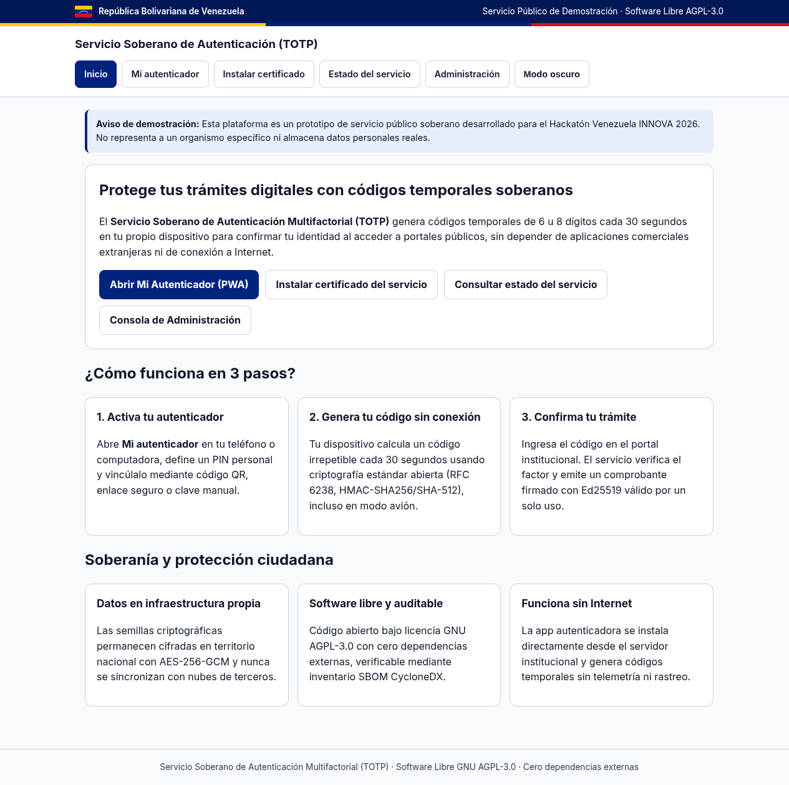 | 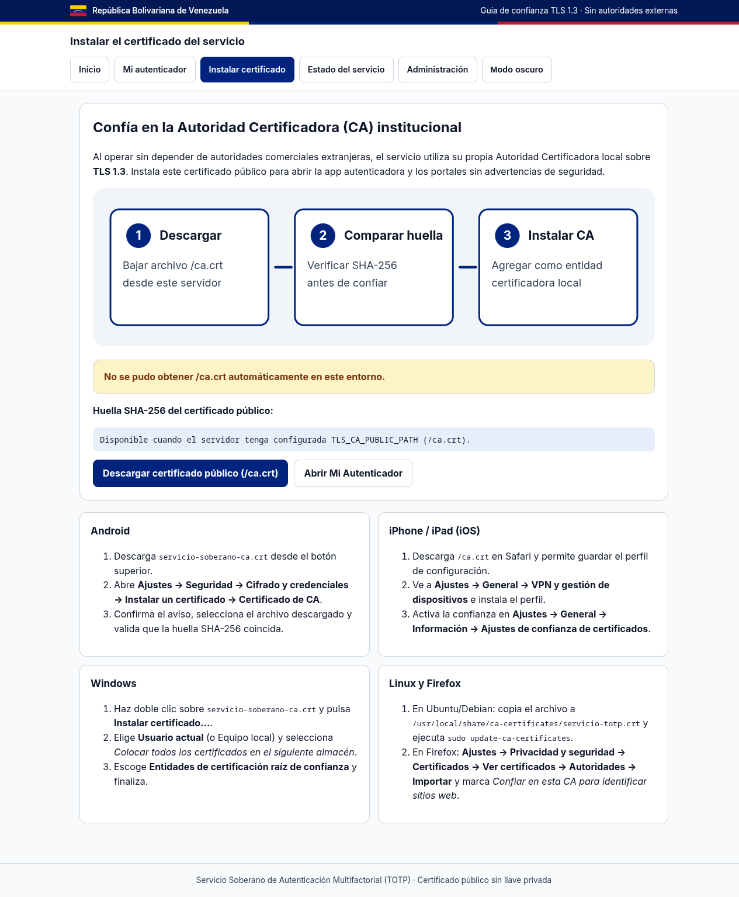 |

| Estado del Servicio (`/estado`) | Inicio (Móvil 390px) |
| :---: | :---: |
| 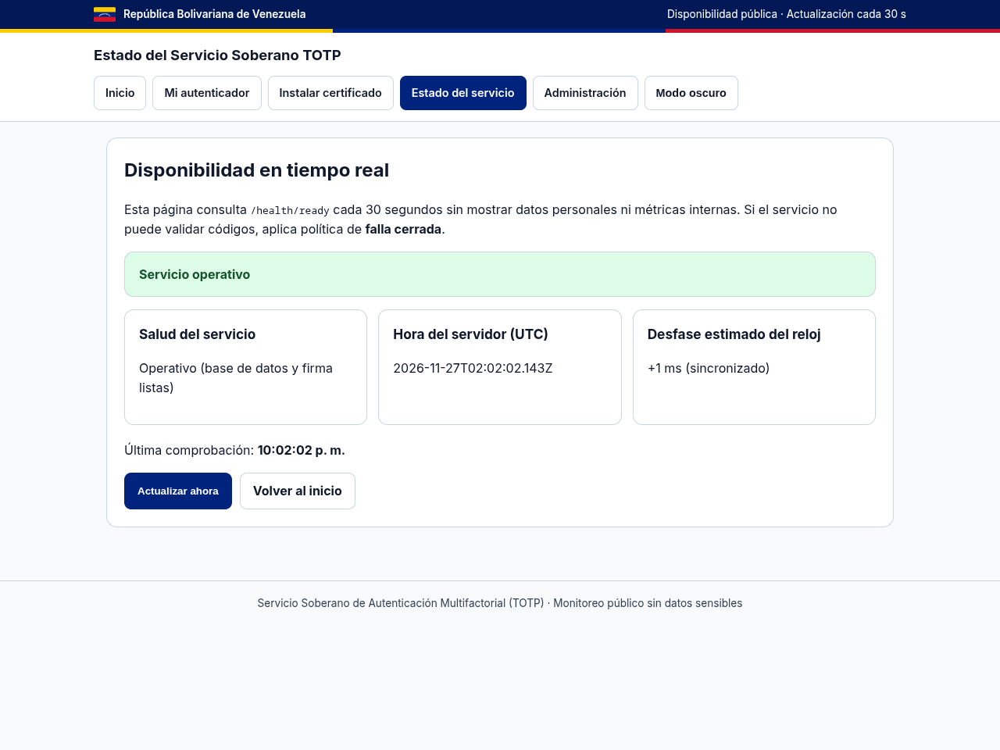 | 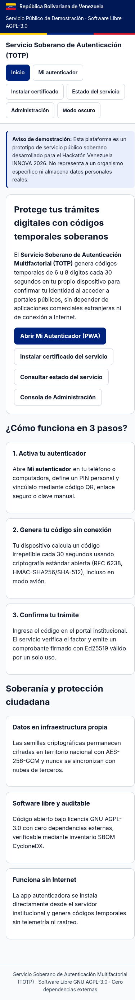 |

---

### Flujo Ciudadano E2E: PWA Autenticadora (`/app/`) y Portal de Trámites Demo

| PWA — Código TOTP SHA-256 en vivo (Escritorio) | PWA — Móvil 390px |
| :---: | :---: |
| 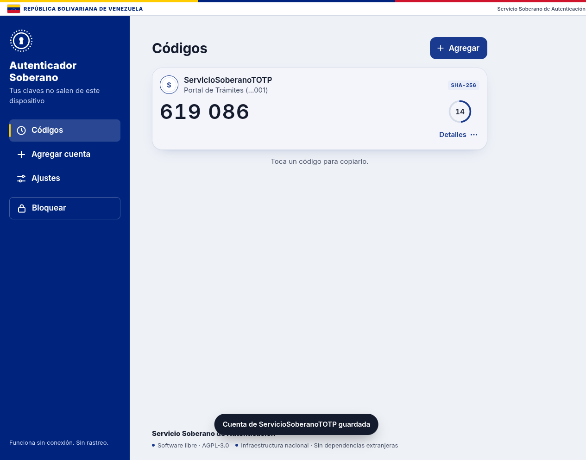 | 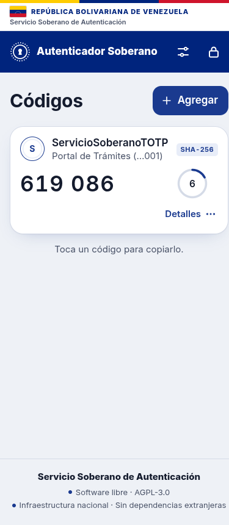 |

| Portal — Panel autenticado con traza Ed25519/JWKS | Portal — Solicitud de Certificado (Step-Up MFA) |
| :---: | :---: |
| 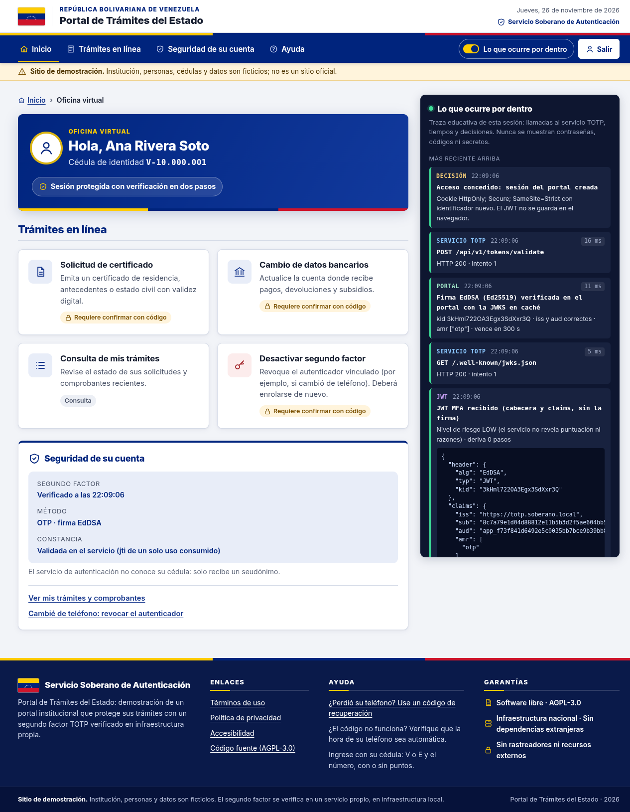 | 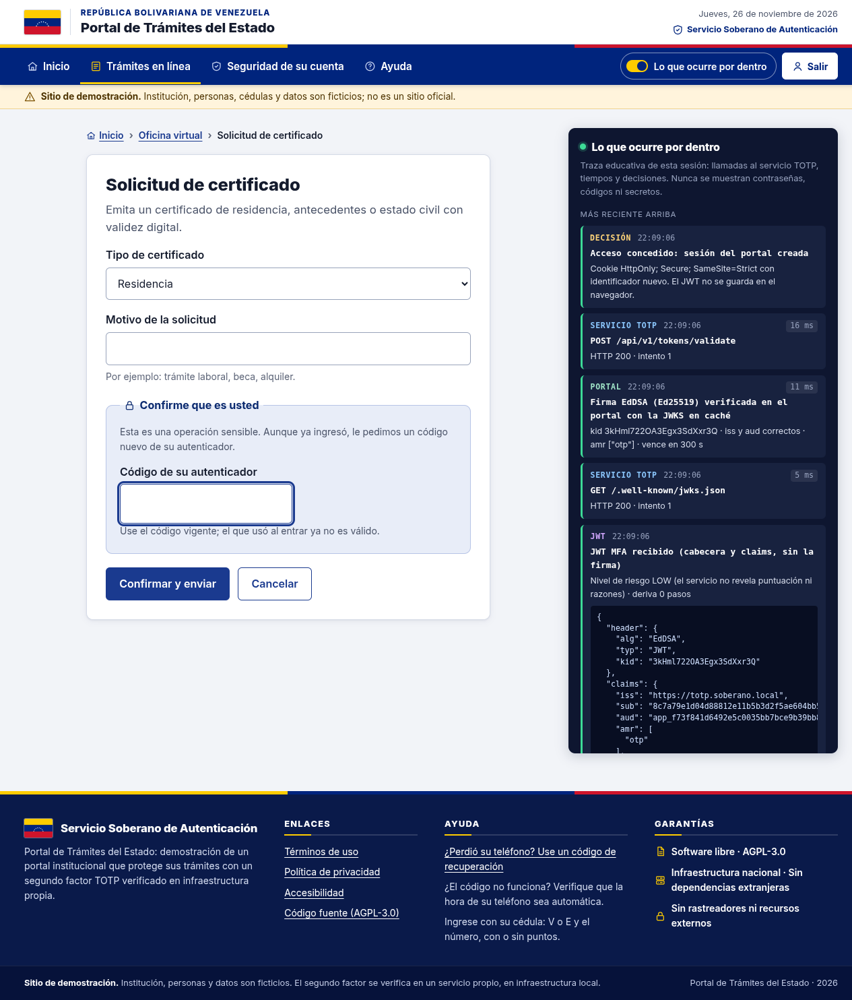 |

| Portal — Panel Móvil 390px |
| :---: |
| 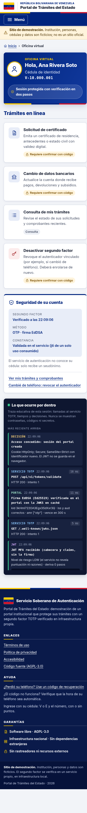 |

---

### Consola Administrativa RBAC (`/consola/`)

| Acceso 2FA (Escritorio) | Panel de Operación en vivo |
| :---: | :---: |
| 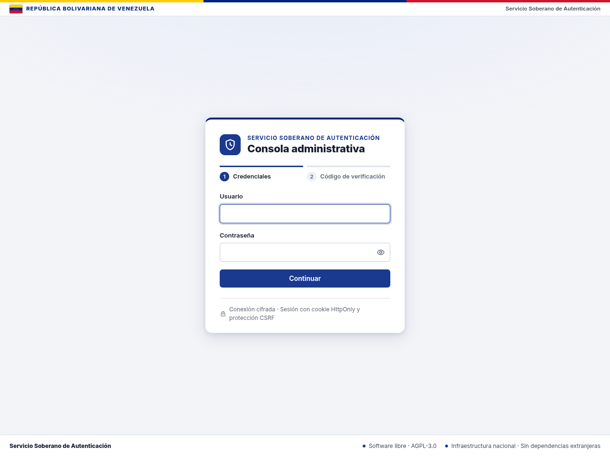 | 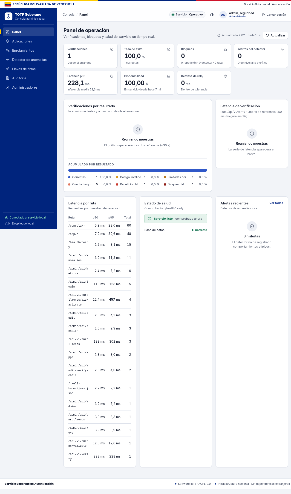 |

| Enrolamientos (hash HMAC sin cédula en claro) | Auditoría — Cadena SHA-256 íntegra (servidor + navegador) |
| :---: | :---: |
| 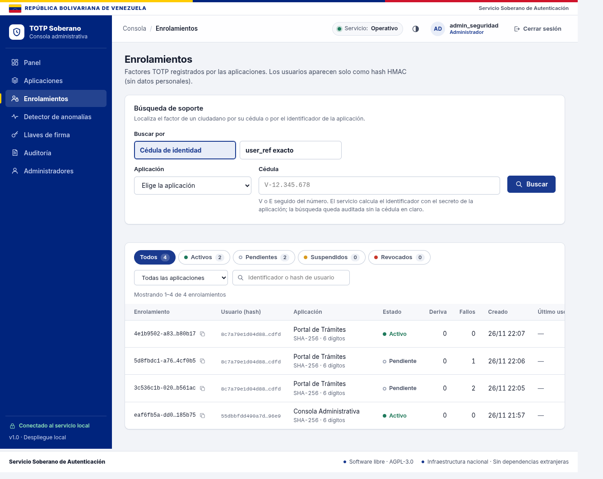 | 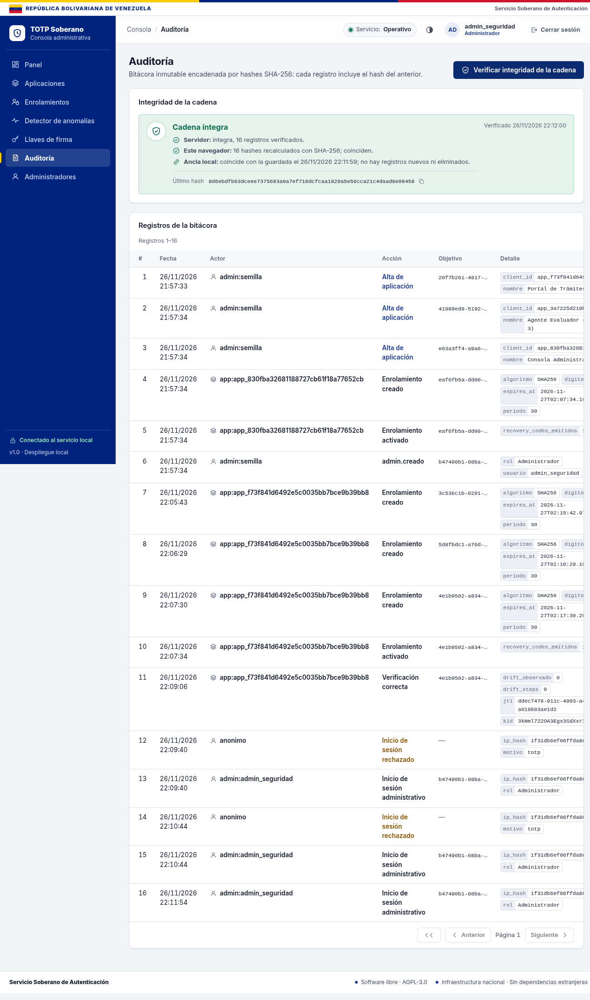 |

| Consola — Vista Móvil 390px |
| :---: |
| 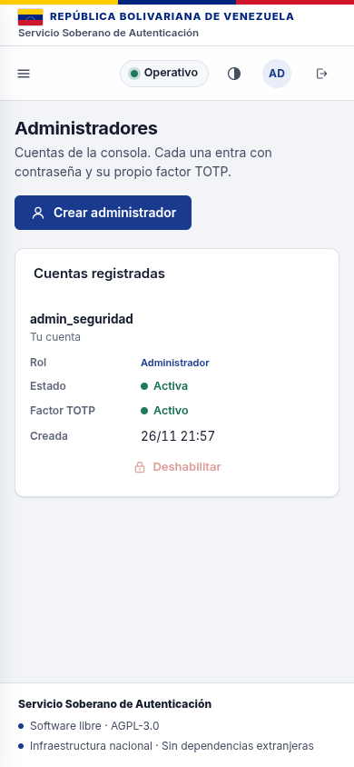 |
