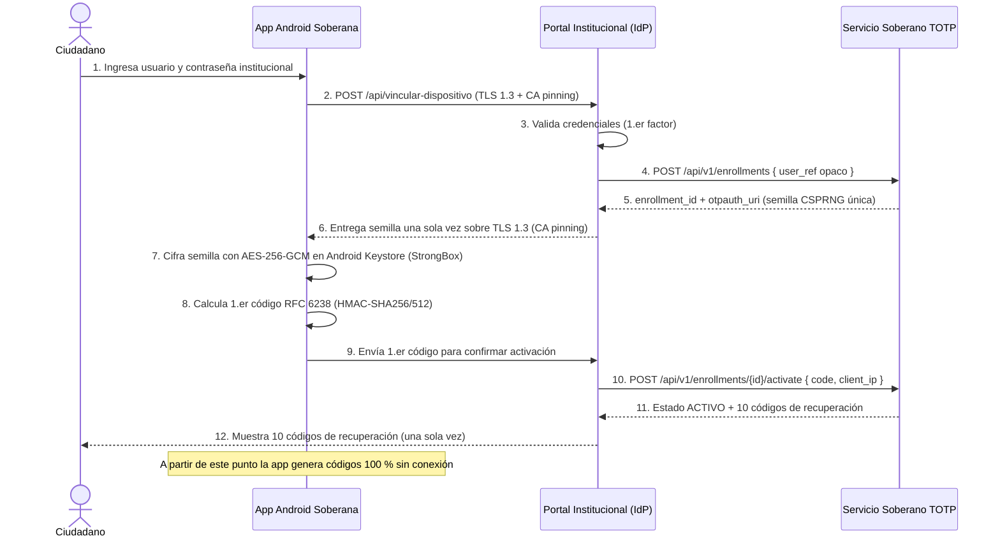

# Autenticador Soberano — App Móvil Android Nativa (`mobile-android/`)

> **Licencia:** GNU AGPL-3.0-or-later · **Decisión arquitectónica:** ADR-004 en [`ARCHITECTURE.md`](../ARCHITECTURE.md) (Issues `#39` M0, `#40` M1, `#41` M2).  
> **Soberanía:** 100 % código propio en Kotlin sobre APIs estándar de Android (`javax.crypto`, `AndroidKeyStore`/StrongBox, `Camera2`, `BiometricPrompt`). **Cero dependencias de Google Play Services, Firebase ni telemetría.**

---

## 1. Estructura del Módulo

```text
mobile-android/
├── README.md
└── app/src/
    ├── main/
    │   ├── AndroidManifest.xml                                    # allowBackup="false", cleartext="false"
    │   └── java/ve/gob/totpsoberano/
    │       ├── core/TotpEngine.kt                                 # Motor RFC 4226/6238 (SHA-1/256/512, 6/8d)
    │       ├── core/CedulaValidator.kt                            # Cédula V/E con/sin puntos → V12345678 / V-12.345.678
    │       ├── core/OtpAuthParser.kt                              # Validación estricta otpauth://totp/
    │       └── security/
    │           ├── KeystoreVault.kt                               # AES-256-GCM en Android Keystore / StrongBox con AAD
    │           └── PinManager.kt                                  # PIN ≥ 6 dígitos (sin secuencias), PBKDF2 y bloqueo progresivo
    └── test/
        └── java/ve/gob/totpsoberano/core/TotpEngineTest.kt        # Vectores RFC 6238 + Cédula + OtpAuth + PIN
```

---

## 2. Flujo de Vinculación Segura con Cédula y Contraseña (Issue `#40` · M1)

> **Invariantes de privacidad y criptografía:**
> 1. El ciudadano ingresa su **cédula de identidad** (`V`/`E` + número, con o sin puntos, normalizada a `V12345678` con `CedulaValidator`) y su contraseña institucional; la lista muestra la cuenta como `V-12.345.678` + nombre de la institución.
> 2. La cédula se envía **únicamente al portal institucional**; el servicio TOTP **nunca** recibe la cédula en claro, solo un seudónimo HMAC (`user_ref`).
> 3. El código TOTP **jamás** se deriva de la cédula ni de la contraseña: la semilla la genera el servicio TOTP con CSPRNG y queda almacenada exclusivamente en **Android Keystore (StrongBox/TEE)**.



---

## 3. Controles de Seguridad Obligatorios

- **Almacenamiento hardware:** semillas cifradas con clave AES-256-GCM no exportable en `AndroidKeyStore` (`setIsStrongBoxBacked(true)` con fallback a TEE) y `setUserAuthenticationRequired(true)`.
- **Sin respaldos en la nube:** `android:allowBackup="false"` y `android:fullBackupContent="false"` en `AndroidManifest.xml`.
- **Protección de pantalla:** `WindowManager.LayoutParams.FLAG_SECURE` en todas las pantallas con códigos o semillas.
- **Distribución soberana (M6):** APK firmado por la institución, publicado en `https://<servidor>:8443/descargas/` junto con su hash SHA-256 en el SBOM (sin depender de Google Play).
